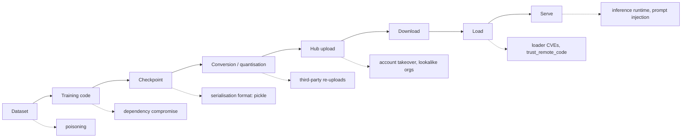

# The ML Model Supply Chain Threat Landscape

Organisations download models from public hubs as casually as they install packages, often with fewer checks. A model artifact can carry **code execution** (unsafe serialisation), **hidden behaviour** (backdoored weights), or **data leaks** (memorised training data). Security tools for models are years behind those for code.

## The chain



Each dotted branch is a place an attacker can enter. The chain is longer than a software supply chain because data and weights are inputs alongside code, and because many models pass through several hands (base model, fine-tune, quantised re-upload) before you download them.

## Threat categories

| Category | Example | Impact |
|---|---|---|
| Malicious serialisation | pickle `__reduce__` payload in a `.bin`/`.pt` file | code execution on load |
| Unsafe layers/config | Keras `Lambda` layers, `trust_remote_code=True` custom code | code execution |
| Loader vulnerabilities | parser bugs in model formats (e.g. GGUF parsing CVEs in llama.cpp-family tools) | code execution, DoS |
| Backdoored weights | trigger phrase causes specific behaviour | integrity, targeted manipulation |
| Typosquatted/re-uploaded models | `meta-llama` lookalike organisation names | any of the above |
| Data poisoning | poisoned web-scale data or fine-tuning sets | backdoors, bias |
| Model theft/extraction | API querying to clone behaviour | IP loss |

Researchers have repeatedly found models on public hubs with pickle payloads (reverse shells, beacons). Most are tests or proofs of concept, but the mechanism is real.

The categories split cleanly by who can detect them. Format-level problems (pickle payloads, unsafe layers) are visible to scanners and fixable by switching formats. Behaviour-level problems (backdoors, poisoning) are invisible to format scanners and need provenance and evaluation. Teams often solve the first and assume they have solved the second.

## Why it matters for security teams

Security teams increasingly *use* models: malware classifiers, LLM triage agents and code scanners. A compromised model in the security pipeline is an attacker inside your defences.

The **AI Reverse Engineering Pipelines** book describes pipelines that feed hostile samples to models; this book is about making sure the models themselves are what you think they are.

## Where models hide in an organisation

Model files rarely live in one registry. Common locations: notebook directories, `~/.cache/huggingface`, container images, object storage buckets used by ML teams, CI caches, and vendor products that bundle models. An inventory is the first control, because you cannot enforce "safetensors only" on files you have not found.

## Worked example

_The `find` and `grep` commands here use standard tools, but this example was not executed in this book's CI; verify locally. Outputs described are expected results, not captured runs._

Goal: a first inventory of model files and risky loading patterns on a shared server or in a repository.

1. Find model-like files by extension.

```bash
find / -xdev \( -name '*.pt' -o -name '*.pth' -o -name '*.bin' -o -name '*.ckpt' -o -name '*.pkl' \
  -o -name '*.h5' -o -name '*.keras' -o -name '*.safetensors' -o -name '*.gguf' -o -name '*.onnx' \) \
  -size +1M 2>/dev/null > models.txt
wc -l models.txt
```

2. Classify by real format rather than extension. PyTorch checkpoints are zip files containing a `data.pkl`; raw pickles start with byte `0x80`.

```bash
while read f; do
  if unzip -l "$f" 2>/dev/null | grep -q 'data.pkl'; then echo "torch-zip(pickle) $f"
  elif [ "$(head -c1 "$f" | xxd -p)" = "80" ]; then echo "raw-pickle $f"
  else echo "other $f"; fi
done < models.txt | sort | uniq -c -w 16
```

3. Find risky loading code in repositories.

```bash
grep -rnE 'trust_remote_code\s*=\s*True|weights_only\s*=\s*False|pickle\.loads?\(|joblib\.load\(' \
  --include=*.py . | head -50
```

4. Record for each finding: owner, source (hub repo and revision, or "unknown"), format, and which service loads it.

Expected result: a table of model files grouped into pickle-based and non-pickle formats, plus a list of code locations that load untrusted formats or remote code. In most organisations the "source: unknown" column is the most informative one.

## Common pitfalls

- Trusting file extensions. `.bin` can be pickle or raw tensors; check the bytes.
- Scanning the model registry but not caches, notebooks and container images.
- Treating "no pickle" as "safe" and ignoring backdoors and loader bugs.
- Allowing `trust_remote_code=True` because a tutorial used it.
- Treating re-uploaded quantised models as equivalent to the original publisher's release.

## Exercises

1. Inventory model files in your organisation: formats, sources, who loads them where.
2. Find the `trust_remote_code` usage in your codebases.
3. List the model formats your inference stack parses, and their parser implementations.
4. For three models in your inventory, trace the chain back to the original publisher and note every intermediate re-upload.

## Further reading

- OWASP Top 10 for LLM Applications (supply chain entry): <https://genai.owasp.org>
- MITRE ATLAS: <https://atlas.mitre.org>
- JFrog and other vendor research on malicious Hugging Face models (2024)
- Hugging Face security docs: <https://huggingface.co/docs/hub/security>
