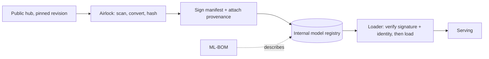

# Signing, Provenance and Model Bills of Materials

Software supply chain security learned to answer "where did this artifact come from, and has it changed?". The same tools now apply to models.

## Model signing

The OpenSSF **model signing** project (`model-transparency`, with a v1.0 release in 2025) signs model directories using Sigstore. It hashes every file in the model and signs a manifest, so tampering with any file, including config and tokenizer files, breaks verification.

```bash
# illustrative; see the project's README for current CLI
model_signing sign ./my-model --signature model.sig
model_signing verify ./my-model --signature model.sig --identity <signer> --identity_provider <oidc issuer>
```

Sign at the point of training/export, verify at the point of loading. Verification belongs in the loader, not in a separate audit step people skip.

Signing the whole directory matters because a model is more than its weights. A modified `tokenizer.json` can change how inputs are split; a modified `config.json` can change architecture parameters; an added Python file can be picked up by `trust_remote_code`. A signature over only the `.safetensors` file leaves all of these open.

## Provenance (SLSA for ML)

Record how a model was produced: training code commit, data snapshot hashes, base model and hyperparameters, build environment. SLSA-style attestations (in-toto) can carry this.

| Provenance field | Answers | Example source |
|---|---|---|
| Base model + revision | "derived from what?" | hub repo and commit hash |
| Training code commit | "which code?" | git SHA |
| Dataset snapshot hashes | "which data?" | manifest of file hashes or dataset version |
| Hyperparameters | "how?" | training config file hash |
| Builder identity | "who/what ran it?" | CI workload identity |

The identity of the builder is the field that makes the rest trustworthy. An attestation signed by a CI workflow identity says "this pipeline produced this artifact from these inputs"; an attestation signed by a laptop key says much less.

## AI/ML Bill of Materials

CycloneDX supports ML-BOMs describing models, datasets and their relationships. An ML-BOM lets you answer "which deployed models derived from base model X?" when X turns out to be compromised.

When an upstream model is later found to be compromised, the ML-BOM turns a frantic search into a query: list every component whose `pedigree` or dependency graph includes the bad base model and revision, then retire or retrain those models. Without it, teams search notebooks and chat history.

## Hub hygiene

- Pin model **revisions by commit hash** (`revision="<sha>"`), not branch names.
- Verify the organisation is the real publisher; beware lookalike names.
- Mirror approved models internally after scanning and signing; production loads only from the mirror.



## Worked example

_Not executed in this book's CI; verify locally. Outputs described are expected results, not captured runs._

Goal: pin a model download to a commit, build a per-file manifest, sign it with cosign, and verify before loading. This uses general-purpose tools; the OpenSSF model signing tool does the manifest step for you and is preferred when available.

1. Download a pinned revision.

```python
from huggingface_hub import HfApi, snapshot_download
repo = "<org>/<model>"
sha = HfApi().model_info(repo).sha                       # record this once, after review
path = snapshot_download(repo, revision=sha, local_dir="model")
print(sha)
```

2. Build a manifest of every file.

```bash
cd model && find . -type f ! -name MANIFEST.sha256 -print0 | sort -z | xargs -0 sha256sum > MANIFEST.sha256 && cd ..
```

3. Sign the manifest (keyless; a browser opens for the OIDC login).

```bash
cosign sign-blob model/MANIFEST.sha256 --bundle model.manifest.sigstore.json --yes
```

4. In the loader, verify identity and every file hash before loading anything.

```bash
cosign verify-blob model/MANIFEST.sha256 --bundle model.manifest.sigstore.json \
  --certificate-identity ml-release@example.com --certificate-oidc-issuer https://accounts.google.com \
  && (cd model && sha256sum --check --quiet MANIFEST.sha256) && echo "verified"
```

5. Tamper test: append a space to `model/config.json` and rerun step 4. Expected: `sha256sum` reports `config.json: FAILED` and the loader refuses to proceed. Also check that a file *added* to the directory is caught; `sha256sum --check` does not notice extra files, so compare the file list too (`find` output against the manifest), which is one reason to prefer the dedicated model signing tool.

## Common pitfalls

- Signing only the weights file and leaving config, tokenizer and code unsigned.
- Verifying signatures in a separate audit job while the production loader skips verification.
- Pinning to `main` or a tag that the publisher can move.
- Accepting any valid Sigstore signature without pinning the signer identity.
- ML-BOMs written once by hand and never updated as models are retrained.

## Exercises

1. Sign a model directory with the OpenSSF tooling and show that modifying `config.json` breaks verification.
2. Write an ML-BOM in CycloneDX for a fine-tuned model and its base.
3. Change a loader to require a pinned revision and a valid signature.
4. Extend the manifest check in the worked example so that added files also fail verification.

## Further reading

- OpenSSF model signing: <https://github.com/sigstore/model-transparency>
- Sigstore: <https://www.sigstore.dev>
- CycloneDX ML-BOM: <https://cyclonedx.org/capabilities/mlbom/>
- SLSA: <https://slsa.dev>
- in-toto: <https://in-toto.io>
- huggingface_hub download guide: <https://huggingface.co/docs/huggingface_hub/guides/download>
