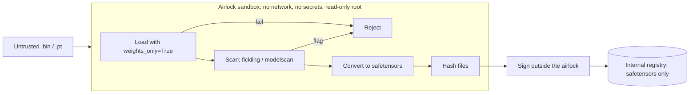

# Sandboxed Loading and Inference

Defence in depth: even with scanning and signing, assume a malicious model will one day reach a loader.

## Isolation layers

| Layer | Purpose |
|---|---|
| Separate process for loading | crash and exploit containment |
| Container with no network | blocks reverse shells and exfiltration |
| gVisor / Firecracker | kernel attack surface reduction |
| Read-only filesystem, no secrets mounted | limits damage of code execution |
| Dedicated GPU nodes without production credentials | limits lateral movement |

Layers matter because each one fails differently. A container without network still lets a payload read every mounted secret; a read-only filesystem still lets it call out if the network is open. A GPU driver exposes a large kernel surface that gVisor only partly covers, so GPU workloads need their own isolation decision. Write down which layers each environment actually has, instead of assuming "it's in a container".

## Conversion airlock

A practical pattern for untrusted checkpoints:



Production never parses pickle. Only the airlock does, and the airlock has nothing worth stealing.

Signing happens outside the airlock, on the hashes the airlock produced. The airlock must never hold signing credentials, or a payload that escapes the loader could sign itself into the registry.

## Parsers in the serving path

Converting to safetensors removes pickle from production, but the serving stack still parses something: safetensors headers, GGUF files for local LLM runtimes, ONNX graphs, tokenizer JSON. Those parsers are written in C, C++ and Rust and have had memory-safety bugs. Keep inference runtimes patched, run them as unprivileged users in their own containers, and prefer loading only files that came through the airlock and the signed registry, so a malformed file crafted to hit a parser bug never reaches production.

## Inference-time risks

- **Tool-using models** in your security pipeline need the same controls as agents (see ai-agent-wallet-security Chapters 2 and 5): untrusted samples can contain prompt injection aimed at the analysis model.
- **Resource exhaustion:** adversarial inputs that maximise generation length or memory.
- **Output handling:** model outputs used in shell commands, SQL or HTML must be treated as untrusted.

For security pipelines specifically, the analysis model reads attacker-controlled samples by design. Run it without tools that act (no shell, no network writes), cap token output and wall-clock time, and parse its output with a strict schema. The **AI Reverse Engineering Pipelines** book (Chapter 6) covers injection-resistant pipeline design.

## Worked example

_Not executed in this book's CI; verify locally. Outputs described are expected results, not captured runs._

Goal: an airlock container that converts an untrusted PyTorch checkpoint into safetensors with no network, no secrets and a read-only root filesystem.

1. Airlock script `convert.py`.

```python
import sys, torch, hashlib, json
from safetensors.torch import save_file
src, dst = sys.argv[1], sys.argv[2]
try:
    obj = torch.load(src, map_location="cpu", weights_only=True)
except Exception as e:
    print(json.dumps({"status": "rejected", "reason": str(e)[:300]})); sys.exit(2)
state = obj.get("state_dict", obj) if isinstance(obj, dict) else None
if not isinstance(state, dict) or not all(isinstance(v, torch.Tensor) for v in state.values()):
    print(json.dumps({"status": "rejected", "reason": "not a flat tensor dict"})); sys.exit(2)
save_file({k: v.contiguous() for k, v in state.items()}, dst)
print(json.dumps({"status": "ok", "sha256": hashlib.sha256(open(dst, "rb").read()).hexdigest()}))
```

2. Run it in a locked-down container (image with PyTorch and safetensors pre-installed). Add `--runtime=runsc` where gVisor is installed.

```bash
docker run --rm --network none --read-only --cap-drop ALL --security-opt no-new-privileges \
  --pids-limit 256 --memory 8g --tmpfs /tmp:rw,size=1g \
  -v "$PWD/in:/in:ro" -v "$PWD/out:/out:rw" airlock:latest \
  python /app/convert.py /in/model.pt /out/model.safetensors
```

3. Test with the benign payload checkpoint from Chapter 2. Expected output: a JSON line with `"status": "rejected"` and a reason naming the disallowed global, and no printed message from the payload. Test with a clean checkpoint. Expected: `"status": "ok"` and a hash.

4. Confirm the isolation claims rather than assuming them: inside the same container, `python -c "import urllib.request; urllib.request.urlopen('https://example.com')"` should fail, `touch /etc/x` should fail, and `env` should show no credentials.

5. Pass the hash to the signing step (Chapter 4), which runs outside the airlock.

## Common pitfalls

- Mounting the user's home directory or cloud credentials into the conversion container "for convenience".
- Running the airlock on a GPU node that also serves production traffic.
- Letting the airlock sign its own output.
- Converting nested or non-tensor checkpoints by falling back to `weights_only=False` when the strict load fails.
- Giving the in-pipeline analysis model shell or network tools.
- Never testing the isolation, so a misconfigured `--network` flag goes unnoticed for months.

## Exercises

1. Build the conversion airlock as a container with `--network none` and a read-only root.
2. Run your benign pickle payload from Chapter 2 through it. Confirm it is rejected or neutralised.
3. Measure the performance overhead of gVisor for an inference workload.
4. Write the isolation checks from step 4 as an automated test that runs whenever the airlock image changes.

## Further reading

- gVisor: <https://gvisor.dev>
- Firecracker: <https://firecracker-microvm.github.io>
- Docker security options: <https://docs.docker.com/engine/security/>
- safetensors: <https://github.com/huggingface/safetensors>
